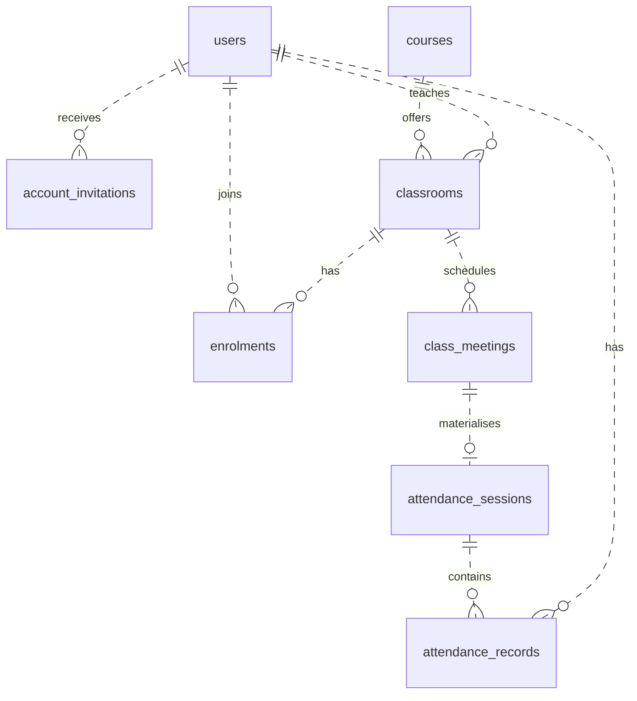
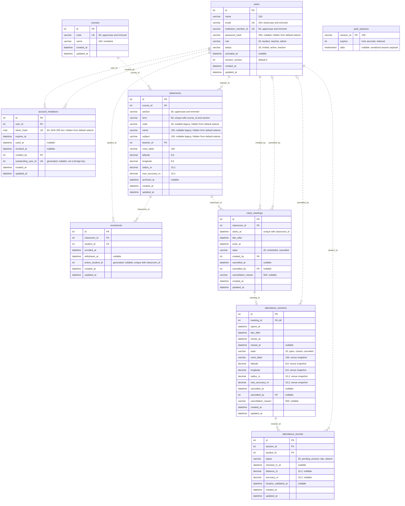

# OpenTexila database ER diagram

Based on the [initial migration](../database/migrations/1793059200000-InitialSchema.js), [course/section migration](../database/migrations/1793145600000-CourseSections.js), and [EntitySchemas](../src/database/entities/). This shows the schema after both migrations: nine application tables, including the adapter-owned `auth_sessions` table. TypeORM's `schema_migrations` and `typeorm_metadata` bookkeeping tables are omitted.

View this Markdown on GitHub or in a Mermaid-capable preview. The diagram describes the implemented database structure; authentication and attendance business services are still planned. See [database design](database-design.md) for validation rules and [API documentation](api/README.md) for implementation status.

## Main relationships

This overview omits audit references (`created_by` and `cancelled_by`) and the separate login session store. The detailed diagram below includes them.

A course stores the shared code/name. A classroom is one section of that course in one academic term, with its own lecturer and venue. Each scheduled meeting can have zero or one attendance session. Each attendance record belongs to one session and one student; a Pending record represents roster eligibility, not a successful check-in.

## Tables, columns and foreign keys

`PK` = primary key; `FK` = foreign key; `UK` = a single-column unique key. Composite unique keys are listed separately below. A field is required unless its comment says nullable. All `int` fields shown are unsigned; the eight domain-table `id` fields auto-increment. All `datetime` fields are `DATETIME(3)` in UTC. Decimal precision and string lengths are shown in comments.

Crow's-foot markers: `||` means exactly one, `o|`/`|o` means zero or one, and `o{` means zero or many. Dotted lines indicate non-identifying relationships: child tables have their own primary keys, rather than using parent IDs as their primary keys. Optionality is shown by the endpoint markers.

## Constraints that the relationship lines do not show

| Table                 | Unique constraint                   | Meaning                                                                                                                                       |
| --------------------- | ----------------------------------- | --------------------------------------------------------------------------------------------------------------------------------------------- |
| `users`               | `email`; `institution_member_id`    | Each is independently unique.                                                                                                                 |
| `account_invitations` | `token_hash`; `outstanding_user_id` | Token digests are unique; at most one unused, unrevoked invitation per user. Expired unused invitations still occupy that slot until revoked. |
| `courses`             | `code`                              | One shared course identity across terms and sections.                                                                                         |
| `classrooms`          | `(course_id, term, section)`        | One section offering per course and term; the legacy `(code, term)` unique key is removed.                                                    |
| `enrolments`          | `(classroom_id, active_student_id)` | One current membership per student/class, with multiple withdrawn historical intervals allowed.                                               |
| `class_meetings`      | `(classroom_id, starts_at)`         | No duplicate start time in one class; overlap checks require service logic.                                                                   |
| `attendance_sessions` | `meeting_id`                        | At most one attendance session for each meeting.                                                                                              |
| `attendance_records`  | `(session_id, student_id)`          | At most one roster/attendance record per student per session.                                                                                 |

- `outstanding_user_id` is generated from `user_id` when both `used_at` and `revoked_at` are null. `active_student_id` is generated from `student_id` while `withdrawn_at` is null. Neither generated field is an additional foreign key.
- All foreign keys use `ON DELETE RESTRICT` and `ON UPDATE RESTRICT`. Role requirements such as student membership, lecturer assignment and administrator-only actions are service rules, not guarantees made by the FK.
- `auth_sessions` has no database FK to `users`. Its serialized payload may hold a user ID when session middleware is implemented; anonymous sessions are also possible. No relationship line is drawn because that FK does not exist.
- Classroom `code`, `name` and `subject` are retained nullable legacy data for guarded rollback. New code reads the course relation and separate section; these fields are not maintained as duplicate current course information. See the [migration limits](course-section-migration-plan.md#migration-operation-and-rollback-limits).
- A student can have enrolments in multiple sections of one course; preventing that requires an agreed service rule, not just the classroom unique key.
- `attendance_sessions` stores a meeting and venue snapshot. It has no duplicate `classroom_id`, session code or `opened_by`. Reach its class through `meeting_id`.
- Present/Late records require all four evidence fields: `checked_in_at`, `distance_m`, `accuracy_m`, and `location_validated_at`. Pending/Absent records require them all to be null. Raw student coordinates are not stored.

Update this diagram alongside future migrations and EntitySchema changes. The migration remains the authority for column definitions, checks and indexes.
