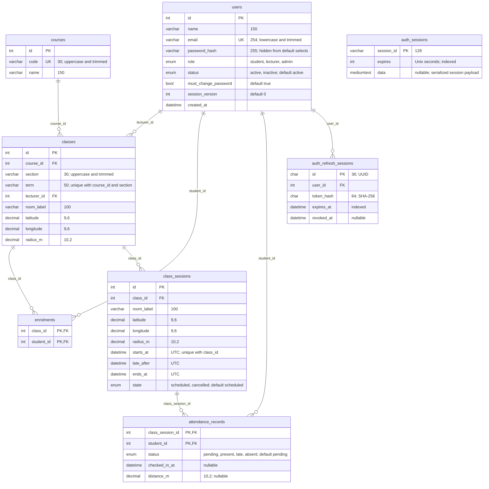

# OpenTexila database ER diagram

**Version 7 · 3 November 2026 · Baseline, venue snapshot and JWT refresh sessions.** This diagram matches the decorated TypeORM entities and migrations (`1793059200000-InitialSchema.ts`, `1793491200000-SessionVenueSnapshot.ts` and `1793664000000-RefreshSessions.ts`). See [database design](database-design.md) and the [baseline setup guide](database-refactor-migration.md).

Eight application tables are shown; TypeORM's `schema_migrations` table is omitted. View in a Mermaid-capable preview. Older generated PNGs, if present, are obsolete; use this Markdown diagram.

`PK` = primary key; `FK` = foreign key; `UK` = unique key. All `int` fields are unsigned; integer `id` fields auto-increment; refresh-session IDs are UUIDs. All `datetime` fields are `DATETIME(3)` in UTC. `auth_sessions` is preserved unused infrastructure with no foreign keys. JWT authentication uses `auth_refresh_sessions`.

## Constraints that the relationship lines do not show

| Table                | Key / unique constraint                | Meaning                                                              |
| -------------------- | -------------------------------------- | -------------------------------------------------------------------- |
| `users`              | `email`                                | Unique, lowercase and trimmed.                                       |
| `courses`            | `code`                                 | One shared course identity across terms and sections.                |
| `classes`            | `(course_id, term, section)`           | One class per course, term and section.                              |
| `enrolments`         | primary key `(class_id, student_id)`   | A student is enrolled in a class at most once.                       |
| `class_sessions`     | `(class_id, starts_at)`                | No duplicate start time in one class; overlap checks are a service rule. |
| `attendance_records` | primary key `(class_session_id, student_id)` | At most one record per student per class session.              |

- All foreign keys use `ON DELETE RESTRICT` and `ON UPDATE RESTRICT`. Role requirements such as student membership and lecturer assignment are service rules, not guarantees made by the FK.
- `users.role`, `users.status`, `class_sessions.state` and `attendance_records.status` are NOT NULL MySQL ENUMs with the values and defaults shown.
- Present/Late records require both `checked_in_at` and `distance_m`. Pending/Absent records require both to be null. Raw student coordinates are not stored.
- Cancelled class sessions are excluded from attendance totals.

The initial migration directly creates this design. Existing databases with the previous baseline need separate recreation; migration history alone cannot distinguish old and rewritten contents with the same migration name.
